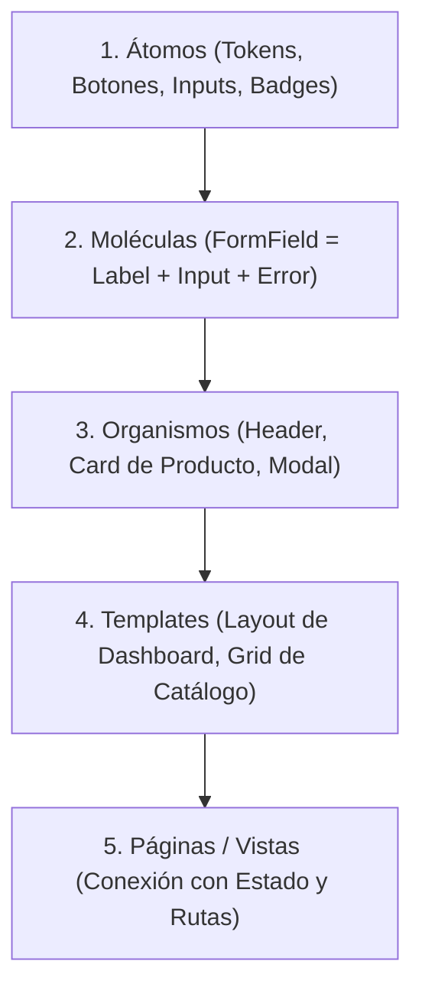

# Frontend Component Architect (Arquitectura de Componentes y Design Systems)

Esta skill guía la construcción de componentes frontend escalables, altamente reutilizables, accesibles y mantenibles.

---

## 1. Principios de Diseño de Componentes



---

## 2. Patrones Avanzados de Componentes

### A. Patrón de Componentes Compuestos (Compound Components)
Evita el "prop-drilling" y los componentes monolíticos con decenas de props booleanas:

```tsx
// Ejemplo: Dialog / Modal Compuesto
<Dialog open={isOpen} onOpenChange={setIsOpen}>
  <Dialog.Trigger>Abrir Modal</Dialog.Trigger>
  <Dialog.Portal>
    <Dialog.Overlay />
    <Dialog.Content>
      <Dialog.Title>Confirmar Acción</Dialog.Title>
      <Dialog.Description>Esta acción no se puede deshacer.</Dialog.Description>
      <Dialog.Close />
    </Dialog.Content>
  </Dialog.Portal>
</Dialog>
```

### B. Patrón Polimórfico (`asChild` / `Slot`)
Permite cambiar el elemento DOM subyacente manteniendo estilos y accesibilidad sin anidar etiquetas incompatibles (ej. botón renderizado como enlace `<a>` de Next.js o React Router):
```tsx
<Button asChild variant="outline">
  <Link href="/dashboard">Ir al Dashboard</Link>
</Button>
```

---

## 3. Estructura de Ficheros por Componente

Organiza cada componente reutilizable en su propio directorio aislado:

```text
src/components/ui/Button/
├── Button.tsx           # Lógica y markup del componente
├── Button.variants.ts   # Variantes de estilos con CVA (Class Variance Authority)
├── Button.types.ts      # Interfaces TypeScript y tipos de props
├── Button.test.tsx      # Tests unitarios de interacción
└── index.ts             # Export público limpio
```

---

## 4. Reglas de Variantes y Tokens (CVA + Tailwind)

Usa siempre **Class Variance Authority (CVA)** para manejar combinaciones de variantes de forma tipada:

* **Intent/Variant:** `primary`, `secondary`, `outline`, `ghost`, `destructive`.
* **Size:** `sm` (32px), `md` (40px), `lg` (48px).
* **Estados interactivos:** `hover:`, `active:`, `focus-visible:ring-2`, `disabled:opacity-50`.
* **Accesibilidad táctil:** Mínimo `min-h-[44px]` y `min-w-[44px]` para interacción móvil.
