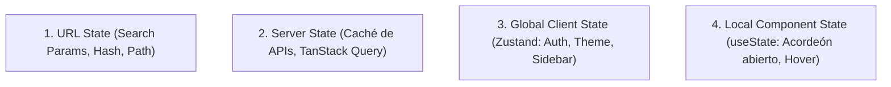
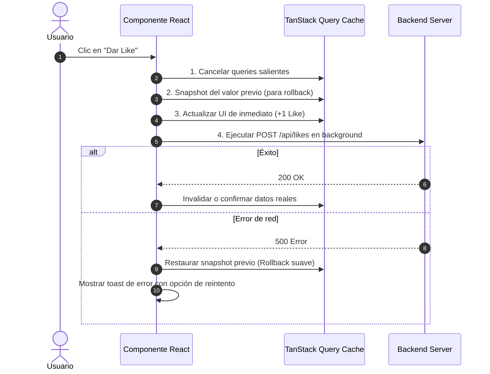

# Frontend State & Data Synchronization (Gestión de Estado y Datos)

Esta skill define la separación rigurosa de los tipos de estado en frontend para evitar sincronizaciones redundantes, bugs de renderizado y pérdida de reactividad.

---

## 1. La Regla de Oro: Las 4 Capas del Estado



### ¿Dónde vive cada dato?
1. **URL State (`?filter=active&page=2`):** Filtros, búsquedas, pestañas y paginación. **Debe ser compartible por enlace.**
2. **Server State:** Datos que provienen de la base de datos o API. **No los copies a un store global (Redux/Zustand)**; usa un gestor de caché (TanStack Query, SWR, RTK Query).
3. **Global Client State:** Estado efímero de la aplicación que cruza múltiples pantallas (ej. estado de sesión en cliente, modo oscuro, carrito en memoria).
4. **Local State:** Estado interno que solo le importa a ese componente específico.

---

## 2. Caché de Servidor con TanStack Query (Best Practices)

### Query Key Factory (Evita strings mágicos)
```typescript
export const userKeys = {
  all: ['users'] as const,
  lists: () => [...userKeys.all, 'list'] as const,
  list: (filters: UserFilters) => [...userKeys.lists(), { filters }] as const,
  details: () => [...userKeys.all, 'detail'] as const,
  detail: (id: string) => [...userKeys.details(), id] as const,
};
```

### Actualizaciones Optimistas (Optimistic UI Pattern)
Para dar feedback instantáneo antes de que el servidor responda:



---

## 3. Estado Global Ligero con Zustand

Usa stores atómicos y selecciona siempre el estado mínimo para evitar re-renderizados innecesarios:

```typescript
// Correcto: Selector atómico (solo renderiza si theme cambia)
const theme = useUIStore((state) => state.theme);

// Incorrecto: Desestructurar el store completo (renderiza ante cualquier cambio)
const { theme, isSidebarOpen } = useUIStore();
```
