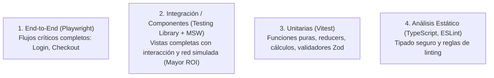

# Frontend Testing & QA (Pruebas Automatizadas Frontend)

Esta skill establece la estrategia para escribir pruebas frontend robustas, que simulen el comportamiento real del usuario y sean inmunes a refactorizaciones de código interno.

---

## 1. El Trofeo de Pruebas (Testing Trophy)



---

## 2. Jerarquía de Selectores en Testing Library

Prueba como un usuario interactúa con la pantalla, no como el desarrollador ve el DOM:

| Prioridad | Selector | Ejemplo | Razón |
| :--- | :--- | :--- | :--- |
| **1. Máxima** | Accesible para todos | `screen.getByRole('button', { name: /guardar/i })` | Simula cómo un lector de pantalla o usuario real encuentra el elemento. |
| **2. Alta** | Contenido textual o semántico | `screen.getByLabelText(/correo electrónico/i)` | Asegura que el formulario esté correctamente etiquetado. |
| **3. Media** | Texto visible | `screen.getByText(/orden confirmada/i)` | Verifica mensajes de confirmación o títulos. |
| **4. Último Recurso** | Atributo de prueba | `screen.getByTestId('custom-canvas')` | Solo para gráficos canvas o elementos sin representación accesible estándar. |

---

## 3. Mocking de Red Limpio con MSW (Mock Service Worker)

**NUNCA** hagas mocks de `global.fetch` o librerías de axios manualmente. Usa **MSW** para interceptar peticiones a nivel de red:

```typescript
import { http, HttpResponse } from 'msw';
import { setupServer } from 'msw/node';

export const handlers = [
  http.get('/api/v1/user/profile', () => {
    return HttpResponse.json({
      id: 'usr_1',
      name: 'Jeisson',
      email: 'jeisson@example.com',
    });
  }),
];

export const server = setupServer(...handlers);
```

---

## 4. Pruebas de Interacción con `@testing-library/user-event`

Usa siempre `userEvent.setup()` en lugar de `fireEvent` para disparar eventos realistas (incluyendo hover, focus y blur):

```typescript
test('debe enviar el formulario con datos válidos', async () => {
  const user = userEvent.setup();
  render(<LoginForm />);

  await user.type(screen.getByLabelText(/correo/i), 'test@example.com');
  await user.type(screen.getByLabelText(/contraseña/i), 'Secret123!');
  await user.click(screen.getByRole('button', { name: /iniciar sesión/i }));

  expect(await screen.findByText(/bienvenido de vuelta/i)).toBeInTheDocument();
});
```
